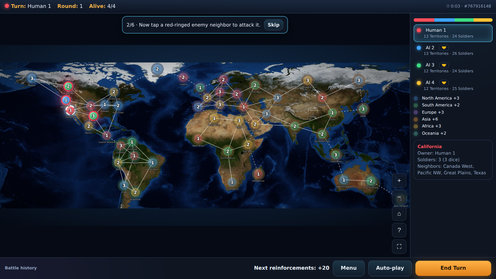
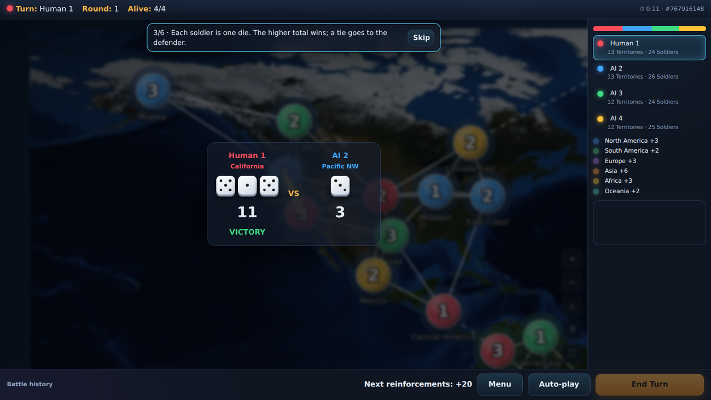
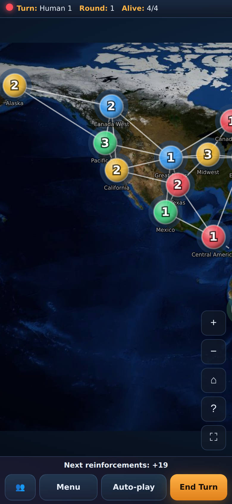
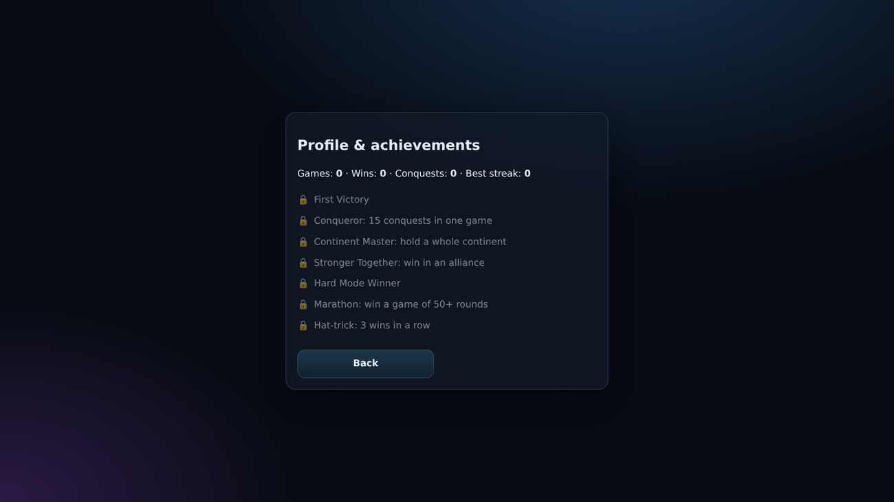
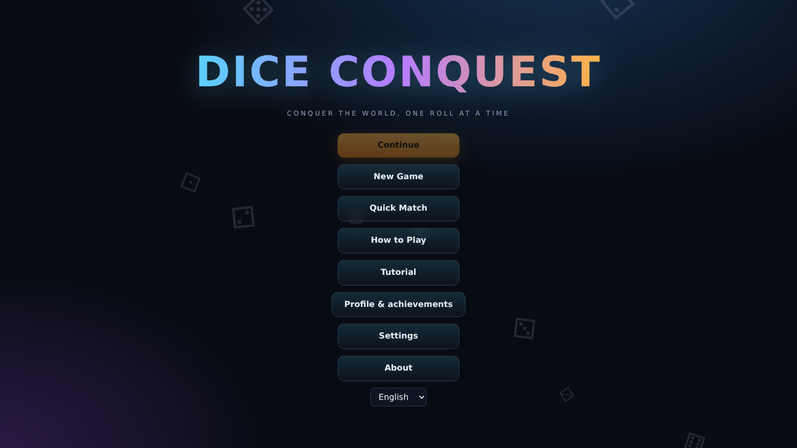

# Dice Conquest — Conquer the World, One Roll at a Time

## Project Introduction
An original offline, turn-based dice strategy game for the browser (Chrome, Edge, Firefox, Safari). No backend required.

## Game Overview
A world map of 50 territories (circles on stylised continents, linked by land and sea routes) forms a graph. Each territory has an owner and soldiers (max 8). 2–8 players (humans and/or AI) fight until one remains.

## Game Rules
1. Select your territory with at least 2 soldiers. 2. Select an adjacent enemy territory. 3. End your turn to receive reinforcements. 4. The last player alive wins.

## Dice Battle Mechanics
Each side rolls exactly one D6 per soldier in its territory. The attacker wins only if its total is strictly greater (ties go to the defender). Afterwards the source territory keeps exactly 1 soldier. On victory all other attacking soldiers move into the conquered territory; on defeat they are lost. Dice results are decided in the engine before the animation plays.

## Territory Conquest
Only adjacent enemy territories can be attacked. Ownership changes with an animated colour transition. After you end your turn you receive dice equal to half of your frontier (links to enemy territories, rounded up, minimum 1) and place them freely on any of your territories below 8 soldiers.

## Player and AI System
Modes: Single Player, AI Battle (0 humans), Local Multiplayer (hot-seat), Quick Match. AI levels: Easy, Normal (best win probability), Hard (win probability plus map position, leader targeting, eliminations, exposure).

## Features
- World map on real NASA imagery: 50 territories on six continents, land and sea routes, continent bonuses
- Exact dice rules: one D6 per soldier, a strictly higher total wins, ties go to the defender, the source territory keeps 1 soldier
- Reinforcement dice = half of your frontier (rounded up, minimum 1) plus continent bonuses, placed anywhere you like (max 8 per territory)
- AI Easy / Normal / Hard (in a 150-game simulation Hard beat Normal in about 95% of duels), auto-play for human seats, AI Battle mode
- Alliances: team mode and in-game diplomacy (propose or break), shared victory
- Online multiplayer with room codes (host-authoritative; verified with two browsers)
- Custom player names and colors, owner symbols for color-blind players
- Optional turn timer and a stalemate rule (30 rounds without a conquest: most territories wins)
- Interactive tutorial, profile with statistics and 7 achievements
- Animated dice with real pips, battle camera, turn banners, capture effects, generated sound effects and ambient music
- Territory names in English, فارسی and 简体中文, full RTL for Persian
- Responsive for phones, tablets and desktops, pinch-zoom, fullscreen, installable PWA with offline cache
- Keyboard and screen-reader support, autosave with versioned and validated saves

## Screenshots
<p align="center"><br><em>Main game screen</em></p>
<p align="center"><br><em>Dice battle with battle camera</em></p>
<p align="center"> &nbsp;&nbsp; <br><em>Mobile layout · Profile and achievements</em></p>
<p align="center"><br><em>Main menu</em></p>

## Technology Stack
Vite, vanilla JavaScript modules, SVG, CSS dice animation, Vitest. No external services.

## Project Structure
`src/engine.js` (dice, battle, reinforcement, alliances, win and stalemate rules) · `src/ai.js` · `src/main.js` (UI, map, online, save, tutorial, stats) · `src/i18n/*.json` and `names.json` · `src/assets/earth.jpg` · `public/` (PWA manifest, service worker, icons) · `tests/engine.test.js` · `docs/screenshots/` · `.github/workflows/deploy.yml`

## Installation
```
npm install
```
## Running Locally
```
npm run dev
```
## Build
```
npm run build
```
## Testing
```
npm run test
```
## GitHub Pages Deployment
Push to `main`, then in Settings → Pages choose Source: GitHub Actions. The workflow builds with the correct base path (`/<repo-name>/`).

## Language Support
English, Persian (RTL), Simplified Chinese. Translations live in `src/i18n/*.json`; the choice is stored in LocalStorage.

## Roadmap
React + TypeScript migration, WebSocket server for online play outside claude.ai, special powers and cards, more maps, replays, recorded audio, UI component tests.

## Contributing
Fork, create a branch, add tests for engine changes, open a pull request.

## Credits
World map imagery: NASA Blue Marble (public domain), stored at `src/assets/earth.jpg` (cropped to 78°N–50°S and compressed).

## License
MIT
