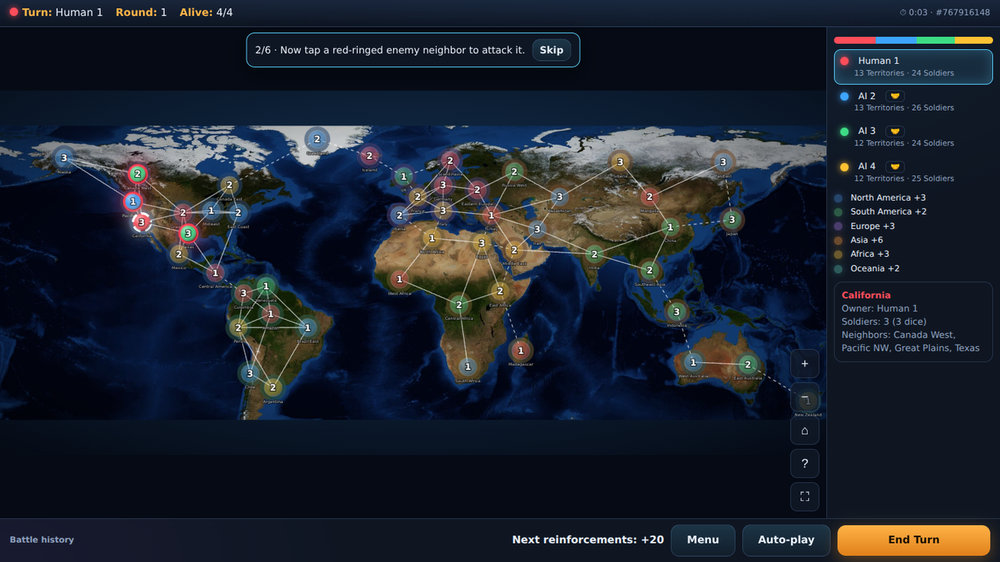
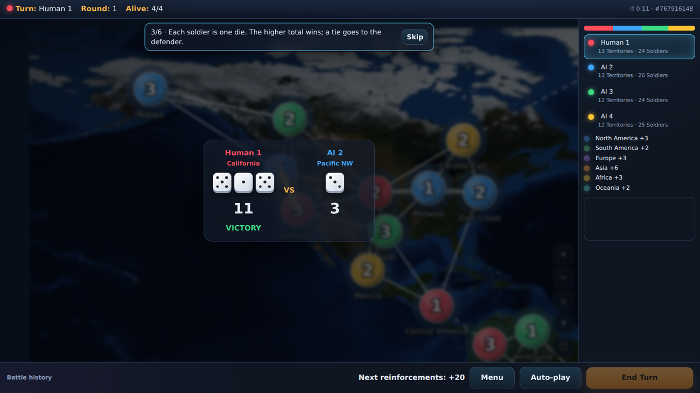
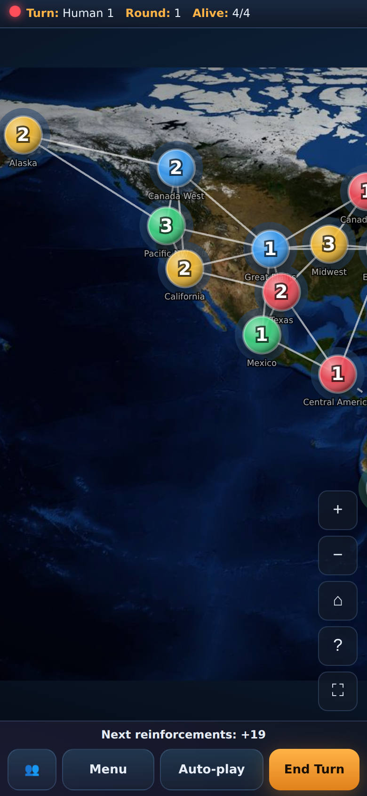
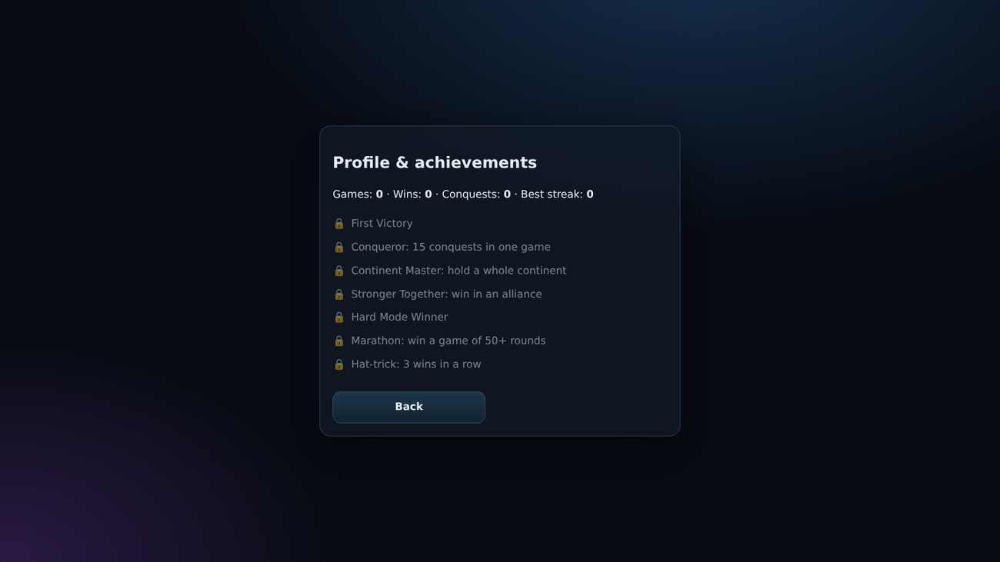
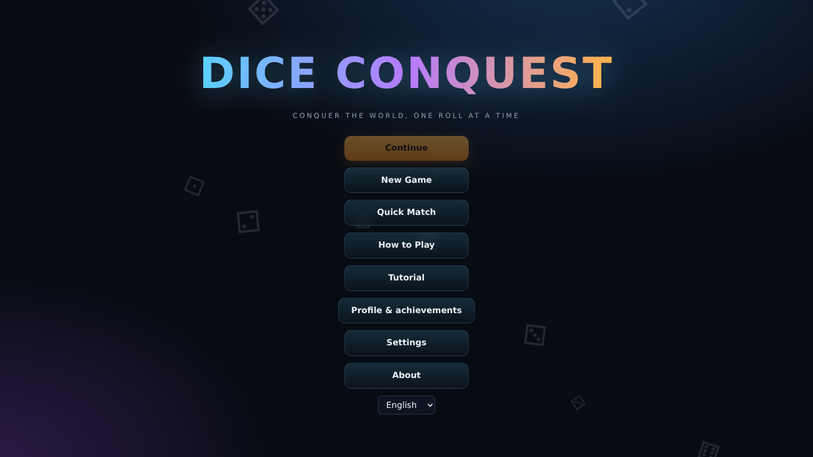

<div dir="rtl" align="right">

# Dice Conquest — با هر تاس، دنیا را فتح کن

## معرفی پروژه
یک بازی استراتژیک نوبتی تاس، اختصاصی و آفلاین برای مرورگر (Chrome، Edge، Firefox، Safari) بدون نیاز به Backend.

## نمای کلی بازی
نقشه جهان با ۵۰ سرزمین (دایره‌ها روی قاره‌ها، با مسیرهای زمینی و دریایی) به‌صورت گراف ساخته می‌شود. هر سرزمین مالک و سرباز دارد (حداکثر ۸). ۲ تا ۸ بازیکن (انسان یا هوش مصنوعی) تا باقی ماندن یک نفر می‌جنگند.

## قوانین بازی
۱. سرزمین خود را با حداقل ۲ سرباز انتخاب کن. ۲. سرزمین دشمن مجاور را انتخاب کن. ۳. با پایان نوبت نیروی کمکی بگیر. ۴. آخرین بازیکن باقی‌مانده برنده است.

## مکانیک نبرد تاس
هر طرف دقیقاً به تعداد سربازهای سرزمینش یک تاس D6 می‌اندازد. مهاجم فقط با مجموع بزرگ‌تر می‌برد (تساوی = برد مدافع). سپس سرزمین مبدأ دقیقاً ۱ سرباز دارد. در پیروزی بقیه سربازان به سرزمین تصرف‌شده می‌روند و در شکست از بین می‌روند. نتیجه تاس‌ها پیش از انیمیشن در موتور بازی تعیین می‌شود.

## تصرف سرزمین
فقط سرزمین‌های دشمنِ مجاور قابل حمله‌اند. تغییر مالکیت با انیمیشن رنگ همراه است. پس از پایان نوبت، تاس‌هایی برابر نصف طول مرز تو با دشمن (گرد به بالا، حداقل ۱) می‌گیری و در هر سرزمین دلخواهِ زیر ۸ سرباز می‌گذاری.

## سیستم بازیکن و هوش مصنوعی
حالت‌ها: تک‌نفره، نبرد AI (۰ انسان)، چندنفره محلی، شروع سریع. سطح‌ها: آسان، معمولی (بهترین احتمال برد)، سخت (احتمال برد به‌علاوه موقعیت نقشه، هدف‌گیری رهبر، حذف حریف و ریسک).

## ویژگی‌ها
- نقشه جهان روی تصویر واقعی ناسا: ۵۰ سرزمین در شش قاره، مسیرهای زمینی و دریایی، پاداش قاره
- قوانین دقیق تاس: به ازای هر سرباز یک D6، مجموع کاملاً بیشتر برنده است، تساوی = برد مدافع، سرزمین مبدأ ۱ سرباز نگه می‌دارد
- تاس کمکی = نصف طول مرز (گرد به بالا، حداقل ۱) به‌علاوه پاداش قاره، در هر سرزمین دلخواه (حداکثر ۸)
- هوش مصنوعی آسان / معمولی / سخت (در شبیه‌سازی ۱۵۰ بازی، سخت در حدود ۹۵٪ دوئل‌ها معمولی را برد)، بازی خودکار برای بازیکن انسانی، حالت نبرد AI
- ائتلاف: حالت تیمی و دیپلماسی حین بازی (پیشنهاد یا شکستن)، پیروزی مشترک
- بازی آنلاین با کد اتاق (میزبان‌محور؛ با دو مرورگر آزمایش شد)
- نام و رنگ دلخواه برای هر بازیکن، نماد مالک برای کوررنگی
- زمان‌سنج اختیاری نوبت و قانون بن‌بست (۳۰ دور بدون تصرف: سرزمین بیشتر برنده است)
- آموزش تعاملی، پروفایل با آمار و ۷ دستاورد
- تاس انیمیشنی با نقطه‌های واقعی، دوربین نبرد، بنر نوبت، افکت تصرف، صدا و موسیقی تولیدشده
- نام سرزمین‌ها به انگلیسی، فارسی و چینی، RTL کامل برای فارسی
- واکنش‌گرا برای موبایل، تبلت و دسکتاپ، زوم دو‌انگشتی، تمام‌صفحه، PWA قابل نصب با کش آفلاین
- پشتیبانی کیبورد و صفحه‌خوان، ذخیره خودکار نسخه‌دار و اعتبارسنجی‌شده

## تصاویر
<p align="center" dir="ltr"><br><em>صفحه اصلی بازی</em></p>
<p align="center" dir="ltr"><br><em>نبرد تاس با دوربین نبرد</em></p>
<p align="center" dir="ltr"> &nbsp;&nbsp; <br><em>نمای موبایل · پروفایل و دستاوردها</em></p>
<p align="center" dir="ltr"><br><em>منوی اصلی</em></p>

## فناوری‌ها
Vite، ماژول‌های JavaScript، SVG، انیمیشن تاس با CSS، Vitest. بدون سرویس خارجی.

## ساختار پروژه
`src/engine.js` (dice, battle, reinforcement, alliances, win and stalemate rules) · `src/ai.js` · `src/main.js` (UI, map, online, save, tutorial, stats) · `src/i18n/*.json` and `names.json` · `src/assets/earth.jpg` · `public/` (PWA manifest, service worker, icons) · `tests/engine.test.js` · `docs/screenshots/` · `.github/workflows/deploy.yml`

## نصب
```
npm install
```
## اجرای محلی
```
npm run dev
```
## ساخت نسخه نهایی
```
npm run build
```
## تست
```
npm run test
```
## انتشار روی GitHub Pages
روی شاخه `main` push کنید و در Settings → Pages گزینه GitHub Actions را انتخاب کنید. Workflow با Base Path صحیح (`/<repo-name>/`) Build می‌کند.

## پشتیبانی زبان
انگلیسی، فارسی (RTL)، چینی ساده. ترجمه‌ها در `src/i18n/*.json` و انتخاب زبان در LocalStorage ذخیره می‌شود.

## نقشه راه
مهاجرت به React و TypeScript، سرور WebSocket برای بازی آنلاین بیرون از claude.ai، قدرت‌ها و کارت‌های ویژه، نقشه‌های بیشتر، بازپخش بازی، صدای ضبط‌شده، تست‌های کامپوننت.

## مشارکت
Fork کنید، شاخه بسازید، برای تغییرات موتور تست بنویسید و Pull Request بدهید.

## منابع
تصویر نقشه جهان: NASA Blue Marble (مالکیت عمومی) در `src/assets/earth.jpg` (برش‌خورده از ۷۸ درجه شمالی تا ۵۰ درجه جنوبی و فشرده).

## مجوز
MIT

</div>
