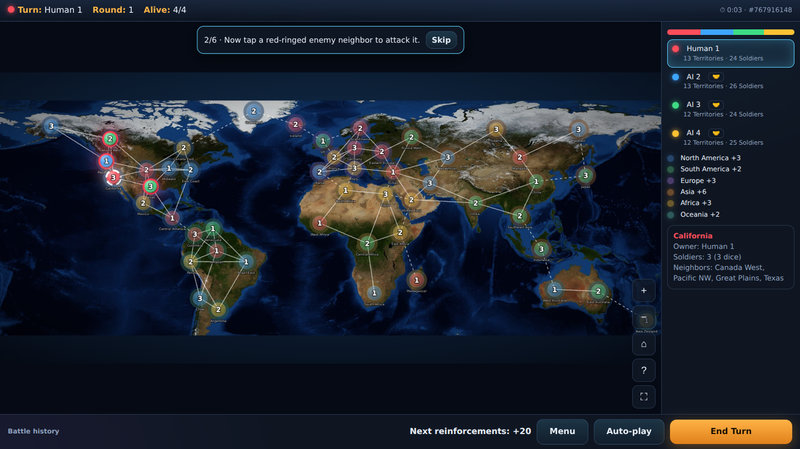
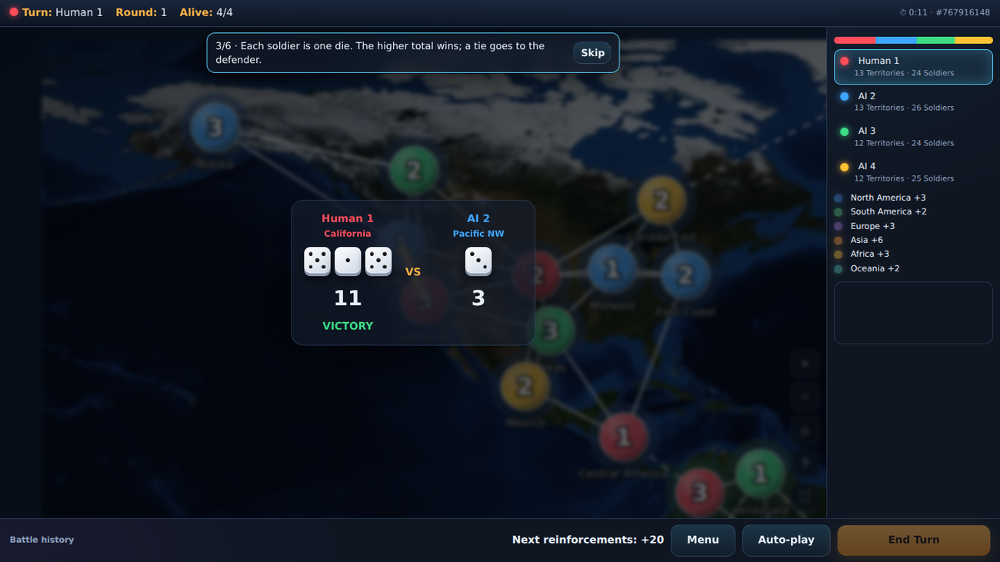
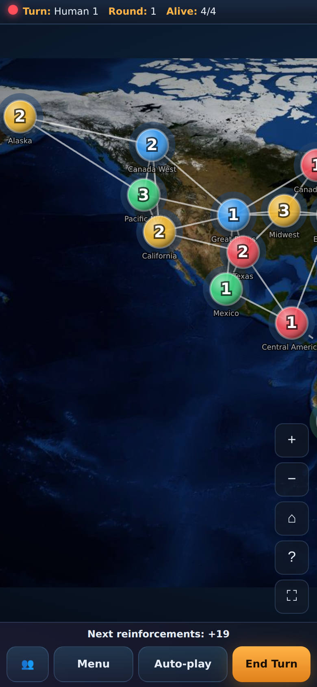
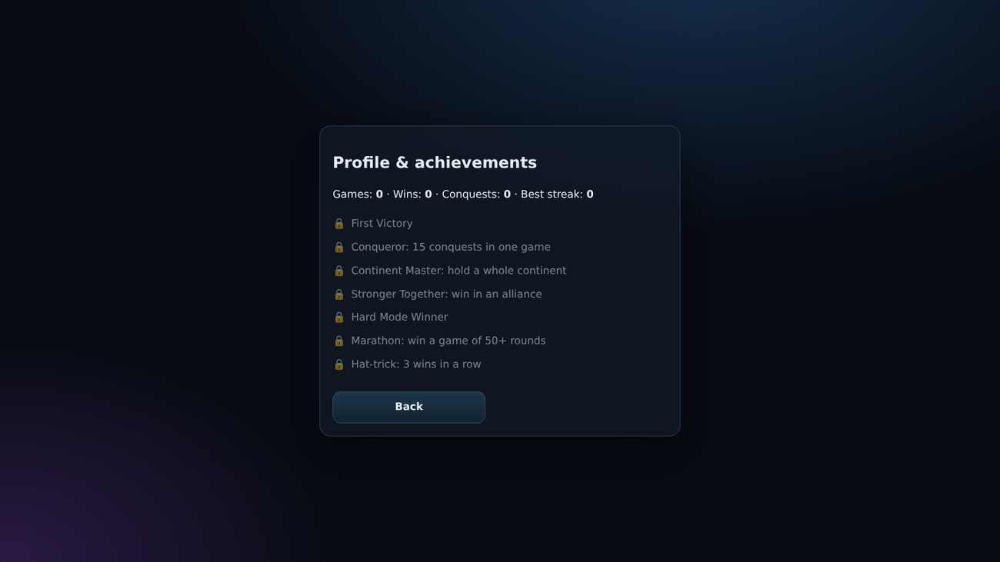

# Dice Conquest — 每一次掷骰,征服世界

## 项目简介
一款原创、离线的回合制骰子策略网页游戏(Chrome、Edge、Firefox、Safari),无需后端。

## 游戏概览
50 块领地(世界地图上的圆形,以陆路和海路连接)构成一张图。每块领地有所有者和士兵(上限 8)。2–8 名玩家(人类或 AI)对战,直到只剩一人。

## 游戏规则
1. 选择至少有 2 名士兵的己方领地。2. 选择相邻的敌方领地。3. 结束回合获得增援。4. 最后存活者获胜。

## 骰子战斗机制
双方各按领地士兵数恰好掷 1 颗 D6。仅当进攻方总点数严格大于防守方时获胜(平局防守方胜)。战后出发地恰好保留 1 名士兵。获胜时其余进攻士兵进驻被占领地,失败则全部损失。骰子结果在动画播放前由引擎确定。

## 领地征服
只能进攻相邻的敌方领地。所有权变化伴随颜色过渡动画。回合结束后,你获得等于边境线(与敌方领地的连接数)一半(向上取整,至少 1)的骰子,可自由部署到任意士兵少于 8 的己方领地。

## 玩家与 AI 系统
模式:单人、AI 对战(0 名人类)、本地多人、快速对局。AI 难度:简单、普通(胜率最高)、困难(胜率结合地图位置、针对领先者、淘汰对手与风险)。

## 功能特性
- 基于 NASA 真实影像的世界地图:六大洲 50 块领地,陆路与海路连接,大洲奖励
- 精确的骰子规则:每名士兵一颗 D6,点数总和严格更高者获胜,平局防守方胜,出发地保留 1 名士兵
- 增援骰子 = 边境线一半(向上取整,至少 1)加大洲奖励,可自由部署到任意己方领地(每块最多 8)
- AI 简单 / 普通 / 困难(150 局模拟中困难约 95% 的对决战胜普通),真人席位自动托管,AI 对战模式
- 联盟:组队模式与游戏内外交(结盟或解除),共同获胜
- 房间码在线多人(房主权威;已用两个浏览器验证)
- 自定义玩家名字与颜色,为色盲玩家提供所有者符号
- 可选回合计时与僵局规则(30 轮无人占领:领地最多者获胜)
- 交互式教程,含统计与 7 项成就的个人资料
- 带点数的动画骰子、战斗镜头、回合横幅、占领特效、程序生成的音效与环境音乐
- 领地名称支持 English、فارسی、简体中文,波斯语完整 RTL
- 手机、平板、桌面自适应,双指缩放,全屏,可安装 PWA 与离线缓存
- 键盘与读屏支持,自动存档(带版本与校验)

## 截图
<p align="center"><br><em>游戏主界面</em></p>
<p align="center"><br><em>带战斗镜头的骰子战斗</em></p>
<p align="center"> &nbsp;&nbsp; <br><em>手机布局 · 个人资料与成就</em></p>
<p align="center"><br><em>主菜单</em></p>

## 技术栈
Vite、JavaScript 模块、SVG、CSS 骰子动画、Vitest。不依赖外部服务。

## 项目结构
`src/engine.js` (dice, battle, reinforcement, alliances, win and stalemate rules) · `src/ai.js` · `src/main.js` (UI, map, online, save, tutorial, stats) · `src/i18n/*.json` and `names.json` · `src/assets/earth.jpg` · `public/` (PWA manifest, service worker, icons) · `tests/engine.test.js` · `docs/screenshots/` · `.github/workflows/deploy.yml`

## 安装
```
npm install
```
## 本地运行
```
npm run dev
```
## 构建
```
npm run build
```
## 测试
```
npm run test
```
## GitHub Pages 部署
推送到 `main` 分支,在 Settings → Pages 中选择 GitHub Actions。工作流会使用正确的基础路径(`/<repo-name>/`)构建。

## 语言支持
英语、波斯语(RTL)、简体中文。翻译位于 `src/i18n/*.json`,选择保存在 LocalStorage。

## 路线图
迁移到 React + TypeScript、用于 claude.ai 之外在线对战的 WebSocket 服务器、特殊能力与卡牌、更多地图、回放、录制音频、组件测试。

## 贡献
Fork、创建分支、为引擎改动补充测试并提交 Pull Request。

## 致谢
世界地图影像:NASA Blue Marble(公有领域),位于 `src/assets/earth.jpg`(裁剪至北纬 78° 至南纬 50° 并压缩)。

## 许可证
MIT
